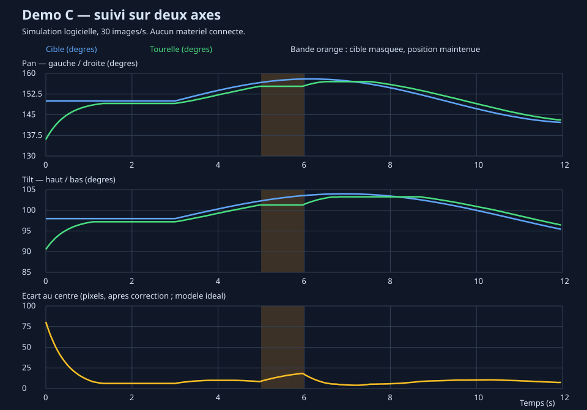

# Démo de référence — caméra qui suit une cible sur deux axes

**Branche `demo` : exemple complet généré avec Codex pour comparer le périmètre du projet avant de le choisir.** La branche `main` conserve le squelette initial. Ce code de référence ne représente pas le travail des quatre étudiants.

Le Raspberry Pi repère une cible lumineuse ou colorée. La caméra est montée sur la tourelle : les servos pan (gauche/droite) et tilt (haut/bas) cherchent à garder la cible au centre de l'image. Une seule caméra suffit. Le mécanisme pointe vers une cible ; il ne déplace pas une main vers un point 3D.



*Graphique produit par les vrais modules de détection et de commande, alimentés par des images synthétiques. Modèle de caméra et de servos idéal : aucune mesure matérielle.*

## Essayer sans Raspberry Pi

Linux, compilateur C11, Make. Python 3 (bibliothèque standard uniquement) sert aux tests d'intégration et au graphique. Ni OpenCV, ni modèle d'IA, ni bibliothèque Python à installer.

```bash
git clone --branch demo https://github.com/abysse8/pantilt-tracker.git
cd pantilt-tracker
make test
make demo
```

`make demo` simule 12 secondes à 30 images/s, écrit `data/simulation.csv` et régénère `docs/demo.svg`. Ouvrir le SVG dans un navigateur. Le modèle dessine chaque image à partir de la cible ET de l'orientation courante : la boucle est réellement fermée. Il teste une cible fixe, son déplacement, sa disparition entre 5 et 6 s, puis sa réapparition. Un petit distracteur est présent.

Pour tester aussi l'exécutable qui traite un flux vidéo :

```bash
./bin/gen_frames 640 480 90 > data/cercle.yuv 2> data/cercle_attendu.csv
./bin/tracker -n -r 30 -c tracker.conf < data/cercle.yuv
head suivi.csv
```

Ici, `-r 30` impose un pas de temps de 1/30 s : la vitesse de lecture du disque n'affecte pas la commande. Ce rejeu de vidéo fixe valide la chaîne d'entrée et le journal ; contrairement à `simulate`, il ne modélise pas le mouvement de la caméra.

**Par défaut, le programme ne commande aucun matériel.** `-a` active explicitement l'I²C. Le mode rejeu `-r` est refusé avec `-a`.

## Algorithmes de base

### Détecter

Entrée : images YUV420 planaires compactes (plans Y, U, V). Y mesure la luminosité ; U/V portent la couleur.

1. Tester un pixel tous les `step` pixels : seuil Y, puis éventuellement seuils U et V.
2. Regrouper les pixels retenus avec leurs quatre voisins sur la grille échantillonnée.
3. Garder le groupe le plus grand dont la surface dépasse `min_area`.
4. Renvoyer son centre moyen, sa surface et un indicateur « trouvé ».

La surface est comptée **après sous-échantillonnage**. Deux objets de même couleur ne sont pas distingués sémantiquement : le plus grand gagne. Les seuils de couleur dépendent de l'éclairage et de la caméra. Le mode lumineux suit le plus grand groupe au-dessus du seuil, pas nécessairement le pixel le plus brillant.

### Commander et stabiliser le suivi

À chaque image, pour chaque axe :

```text
erreur_px = centre_cible - centre_image
si abs(erreur_px) <= zone_morte : vitesse = 0
sinon : vitesse = direction × kp × erreur_px × champ_camera_deg / taille_image_px
vitesse = limiter(vitesse, -vitesse_max, +vitesse_max)
angle = angle + vitesse × dt
angle = limiter(angle, butee_min, butee_max)
```

`kp` est en s⁻¹, `vitesse` en degrés/s, `dt` en secondes. Le champ de vision fournit une approximation linéaire de l'écart angulaire ; ce n'est pas une calibration optique. La zone morte évite les microcorrections. En direct, `dt` vient de l'horloge monotone et est plafonné à 0,1 s après un blocage du flux. Les angles effectivement bornés sont réinjectés dans l'état du contrôleur.

Cible perdue : maintien de la dernière position, sans balayage automatique. Cible retrouvée : reprise immédiate. Un servo de loisir a déjà sa boucle interne de position ; notre commande agit sur la direction de visée, sans mesure indépendante des angles réels.

## Modules et répartition possible à quatre

| Personne | Module | Travail propre | Vérification |
|---|---|---|---|
| A | `src/vision.c`, `src/frame.c` | Acquisition des images, seuils, groupes et centroïde | Images artificielles, vidéo enregistrée |
| B | `src/servo.c` | Protocole PCA9685, impulsions, butées, arrêt | Registres simulés puis un servo réel |
| C | `src/control.c` | Gain proportionnel, zone morte, vitesse, perte de cible | Tests unitaires et simulation fermée |
| D | `src/config.c`, `src/log.c`, `src/main.c` | Configuration, erreurs, journal, boucle et intégration | Tests de l'exécutable, CSV, arrêt |

```text
rpicam-vid → entrée standard → frame_read → vision_detect
                                               ↓
                          CSV ← angles ← control_update
                                   ↓
                              servo_write → PCA9685 → servos
```

Cette version complète comprend aussi les tests, le générateur d'images, la simulation et le graphique. **Ce n'est pas une promesse de tout réécrire en huit heures.** Pour votre version de cours, une cible unique sur fond contrôlé permet de remplacer le regroupement par un simple centroïde des pixels retenus. La priorité est de faire fonctionner séparément caméra et servos avant de les réunir. La détection de doigts, la stéréovision et la cinématique d'un bras ne sont pas incluses.

## Utiliser le Raspberry Pi 5

### Matériel et configuration à vérifier

Cette implémentation suppose que la carte 16 voies est une **PCA9685**. La couleur du circuit imprimé ne suffit pas à l'identifier. Les nombres 270°/180° et 500–2500 µs dans `tracker.conf` sont des **exemples non confirmés pour vos servos**. Vérifier leurs références et la course autorisée avant d'activer `-a`.

- Pi 3,3 V → **VCC logique** de la carte ; GND → GND ; GPIO2/SDA (broche 3) → SDA ; GPIO3/SCL (broche 5) → SCL.
- Pan sur voie 0, tilt sur voie 1 par défaut. Vérifier la polarité des connecteurs.
- Alimentation servo externe régulée à la tension prévue par les servos. Ne pas utiliser les GPIO ou le rail du Pi pour les alimenter. Relier les masses.
- Vérifier aussi la tension admissible du module, le condensateur, les borniers et le courant admissible de ses pistes. La PCA9685 produit les signaux : elle ne régule pas l'alimentation des moteurs. Si nécessaire, distribuer la puissance directement aux servos et ne faire passer que leurs signaux par la carte.
- La nappe caméra du Pi 5 utilise un connecteur mini 22 broches côté Pi.

Les butées fournies sont limitées à ±10° autour du centre illustratif. Le premier envoi au centre peut quand même provoquer un mouvement important : tester sans charge et confirmer le montage. À l'arrêt, les PWM sont coupées **sans recentrage automatique**. La gravité peut alors faire retomber le support ; le soutenir pour les essais. Une interruption brutale du programme ou la perte du Pi peut laisser la PCA9685 émettre sa dernière consigne : l'arrêt logiciel n'est pas un arrêt d'urgence matériel.

### Préparer et lancer

Sur Raspberry Pi OS récent, avec `rpicam-apps`, compilateur/Make et les outils I²C disponibles :

```bash
sudo raspi-config nonint do_i2c 0
# Redémarrer si nécessaire ; le compte doit avoir accès à /dev/i2c-1.
i2cdetect -y 1
rpicam-hello --list-cameras
make
```

L'adresse attendue est généralement `40`, à vérifier sur votre carte. Le pilote utilise un oscillateur nominal de 25 MHz et un prescaler 121 (environ 50 Hz). La précision réelle des impulsions dépend de la carte.

Faire d'abord un essai caméra **sans moteurs** :

```bash
rpicam-vid -t 10000 -n --codec yuv420 --width 640 --height 480 --framerate 30 -o - \
  | ./bin/tracker -n -c tracker.conf
```

Après vérification des servos, du câblage, de l'alimentation et de `tracker.conf` :

```bash
rpicam-vid -t 0 -n --codec yuv420 --width 640 --height 480 --framerate 30 -o - \
  | ./bin/tracker -a -c tracker.conf
```

Ctrl-C coupe les sorties PWM. Une erreur I²C, une image tronquée ou un problème d'écriture du journal entraîne une sortie en erreur. Un fichier vidéo vide se termine normalement. Sans images, les consignes précédentes restent inchangées jusqu'à l'arrêt.

Le lecteur attend des plans compacts, sans en-tête ni padding. Utiliser les mêmes dimensions des deux côtés, largeur multiple de 64 et hauteur paire (640×480 est l'exemple prévu). Un autre producteur vidéo avec stride/padding doit être converti avant l'entrée.

Réglage : vérifier d'abord `pan_dir` et `tilt_dir` à faible vitesse. Si la cible s'éloigne du centre, inverser le signe correspondant. Ajuster le gain, puis la zone morte. Le champ de vision par défaut est illustratif. Pour une cible colorée, activer `use_color=1` et ajuster les seuils Y/U/V sur vos propres images ; aucune valeur universelle pour un bouchon rouge n'est promise.

## Ce qui est vérifié

`make test` vérifie détection, couleur, distracteur, images tronquées, commande, indépendance à la cadence, perte de cible, butées, configuration, journal, simulation fermée, rejeu complet et arrêt SIGTERM sans images. Un test avec des appels système simulés vérifie les octets I²C et les erreurs de communication. Les sorties attendues en erreur font partie des tests.

**Le matériel réel n'a pas été testé.** La simulation ne représente ni inertie, ni jeu mécanique, ni délai caméra, ni comportement électrique. Les tests ne prouvent pas la stabilité du montage réel. GitHub Actions relance les tests logiciels sur `demo`.

Sources des interfaces : [fiche technique NXP PCA9685](https://www.nxp.com/docs/en/data-sheet/PCA9685.pdf), [documentation officielle des outils caméra Raspberry Pi](https://www.raspberrypi.com/documentation/accessories/camera-software.html).
